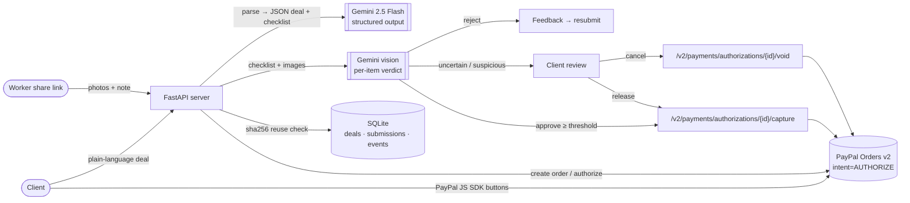
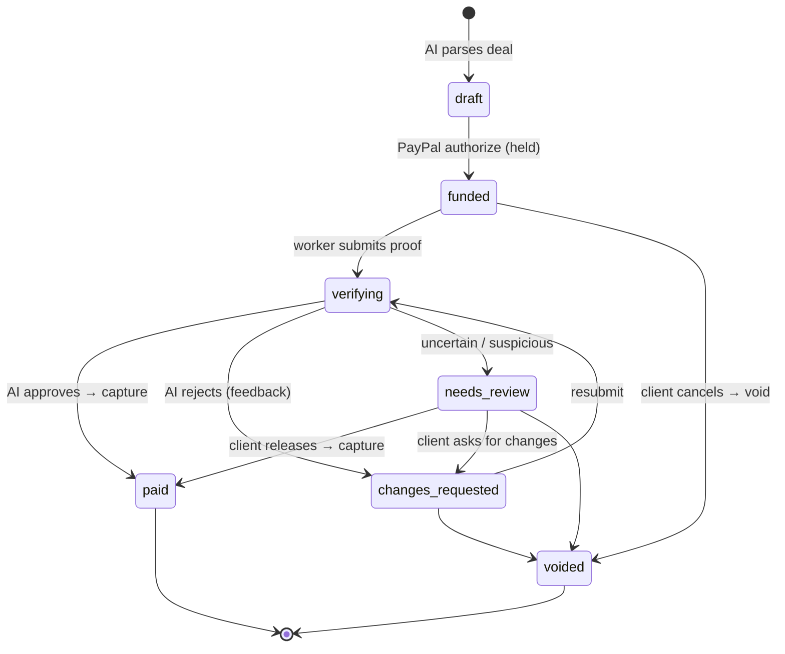

# ProofPay — pay when the work is proven ✅

**Escrow-style PayPal payments for informal gig deals, with an AI agent that checks proof of work before any money moves.**

Built for the PayPal AI Hackathon. Uses **PayPal Orders v2 (intent `AUTHORIZE`) + Payments v2 (capture / void)** and **Google Gemini** (text and vision).

---

## The problem

Millions of small jobs are agreed over chat: *"Ravi will paint my balcony wall white for $40 by Saturday."*
Nobody wants to pay first or work first:

- **Clients** pay up front and hope the job gets done, or the job gets done badly.
- **Workers** finish the job and then chase payment for weeks.
- Marketplaces with escrow exist, but they are heavy and take big fees. They don't fit a neighbour, a tutor or a delivery run.

## The solution

ProofPay turns a one-line deal into a **funded, verifiable agreement**:

1. **Describe it.** The client types the deal in plain language. Gemini pulls out the worker, task, amount, deadline and a **checklist of proof criteria a photo can show**.
2. **Fund it.** The client pays with PayPal. The order uses `intent=AUTHORIZE`, so the money is **held, not captured**.
3. **Prove it.** The worker opens a share link and uploads photos and a note.
4. **Verify it.** A Gemini vision agent judges the proof **item by item**. For each item it gives pass/fail, a confidence score and its reasoning, then an overall verdict. It also flags suspicious proof such as stock photos, screenshots or a photo already used on another deal.
5. **Release it.**
   - Approved, above the confidence threshold and not suspicious → the server **captures** the authorization and the worker is paid.
   - Rejected → the worker gets **specific feedback** ("the right half of the wall is still unpainted") and can resubmit.
   - Unsure or suspicious → the **client decides**: release, ask for changes, or **void** the hold.
   - Every step is written to a **deal timeline / audit log**.

## How it works



**Async AI review.** Gemini can take minutes on free infrastructure, so nobody waits on it. Creating a deal returns at once with an instant rule-based draft (`ai_status: refining`), and Gemini refines it in a background thread. Its result is applied only if the deal is still a draft the client hasn't edited; otherwise it is just logged. Uploading proof also returns at once (deal `verifying`, submission `ai_reviewing`). The verdict and the money decision are applied in the background, exactly once, under a lock plus an atomic status check, so a deal can't be captured twice. The pages show a spinner and pick up the result by polling. If the AI fails, times out or the server restarts mid-review, the deal goes to client review and is never auto-paid. In mock mode everything still completes instantly.

**Deal state machine**



### Safety rails

- **Money only moves on a clear decision.** Auto-capture needs `overall=approve`, *every* item passing, confidence ≥ `APPROVAL_THRESHOLD` (default 0.75) and no fraud flag. If Gemini says "approve" while an item fails, ProofPay downgrades the verdict to *uncertain*. If the AI call errors or is interrupted, the deal goes to client review and is **never** auto-released.
- **Idempotent PayPal calls.** Each authorize, capture and void sends a `PayPal-Request-Id`, so a retry can't capture twice. State changes use an atomic compare-and-set in SQLite.
- **Fraud signals.** The server hashes every photo (SHA-256). A photo already used on another deal or an earlier submission is flagged and passed to the AI as a fact.
- **Separate links.** The client link controls money. The worker link can only see the checklist and upload proof.
- **Terms lock** once funded.

## Quick start (mock mode, no keys, about 1 minute)

```bash
git clone <your-repo-url> proofpay && cd proofpay
python -m venv .venv && source .venv/bin/activate      # Windows: .venv\Scripts\activate
pip install -r requirements.txt
uvicorn app.main:app --reload
```

Open http://localhost:8000. The header badges show `AI: mock · PayPal: mock`.

**Try the full flow in mock mode**

1. Click the 🎨 **Painter** example → **Create deal with AI**.
2. Review the terms, then click **PayPal · Authorize $40** (simulated create order → authorize).
3. Click **Open worker view ↗**.
4. Upload `demo_assets/wall_half.jpg` with the note `half done, ran out of paint` → **rejected**, with per-item feedback.
5. Upload `demo_assets/wall_done.jpg` with the note `Two coats done, edges clean` → **approved → captured → Paid** 🎉
6. Optional: name a file `stock-photo.jpg`, or reuse a photo from another deal → **flagged as suspicious → client review**.

The mock AI is deterministic. It **rejects** when the note says the job isn't finished ("half", "incomplete", "not done", "ran out", "unfinished"…). It **flags** stock or downloaded images ("stock", "google", "screenshot"… in the note or file name, or a reused photo). Otherwise it **approves**. The real Gemini agent looks at the actual pixels.

Run the tests:

```bash
pytest -q
```

## Real sandbox mode (free keys)

Copy `.env.example` to `.env` and fill in the keys. Each part switches to real mode on its own when its keys are present.

### 1. PayPal sandbox (free)

1. Log in at https://developer.paypal.com with any PayPal account, or sign up free.
2. Go to **Apps & Credentials** → make sure the **Sandbox** toggle is on → **Create App** (type: Merchant).
3. Copy the **Client ID** into `PAYPAL_CLIENT_ID` and the **Secret** into `PAYPAL_CLIENT_SECRET`. Keep `PAYPAL_BASE=https://api-m.sandbox.paypal.com`.
4. **Test buyer login:** open **Testing Tools → Sandbox Accounts**. PayPal creates a *Personal* account for you (`sb-xxxxx@personal.example.com`). Click **⋯ → View/Edit account** to see or set its password. Use that email and password in the PayPal pop-up when you fund a deal. No real money is involved.
5. Check the result in the sandbox merchant dashboard (https://www.sandbox.paypal.com, using the *Business* sandbox account). The authorization shows as held, then as captured or voided.

> PayPal authorizations have a 3-day honor period and stay valid for up to 29 days. ProofPay shows the expiry PayPal returns in the timeline.

### 2. Google Gemini (free tier)

1. Go to https://aistudio.google.com/apikey → **Create API key**.
2. Put it in `GEMINI_API_KEY`. You can change the model with `GEMINI_MODEL` (default `gemini-3.8-flash`).
3. Optional: `GEMINI_FALLBACK_MODEL` (default empty) is tried once if the main model still returns 404/503 after retries. `GEMINI_TIMEOUT` (per call, default 150 s) and `GEMINI_TOTAL_BUDGET` (default 330 s) are generous because AI runs in the background. On startup the server logs one line listing the "flash" models your key can use.

Restart `uvicorn`. The badges change to `AI: gemini:gemini-3.8-flash · PayPal: sandbox`, and the client page shows the real PayPal Smart Buttons.

## Deploy free on Render

1. Push the repo to GitHub.
2. In Render: **New → Blueprint** → pick the repo. `render.yaml` sets everything up.
3. Optional: add `GEMINI_API_KEY`, `PAYPAL_CLIENT_ID` and `PAYPAL_CLIENT_SECRET` in the service's **Environment** tab. Without them the hosted demo runs in mock mode.

The free disk is temporary, so deals reset whenever the service sleeps or redeploys. That's fine for judging.

## Architecture & code map

| Path | What it does |
|---|---|
| `app/main.py` | FastAPI app: HTML pages (`/`, `/c/{client_token}`, `/w/{worker_token}`) and the JSON API |
| `app/services.py` | Escrow state machine: parse → fund → verify → capture / void, decision policy, audit log |
| `app/ai.py` | `GeminiAgent` (REST `generateContent` with `responseSchema` JSON output, inline images), `MockAgent`, output normalisation |
| `app/paypal.py` | `PayPalClient` (OAuth, Orders v2 create/authorize, Payments v2 capture/void, idempotency) and `MockPayPal` |
| `app/db.py` | SQLite tables `deals`, `submissions`, `events` with atomic status transitions |
| `app/templates`, `app/static` | Mobile-friendly UI in vanilla JS (no build step), PayPal JS SDK buttons |
| `tests/` | End-to-end mock-mode flow tests, plus tests that run the real PayPal and Gemini clients against fake HTTP transports |
| `demo_assets/` | Sample "half-painted" and "finished" wall photos for the demo. These are AI-generated; use real phone photos for your own video. |

### API

| Method | Path | Who |
|---|---|---|
| POST | `/api/deals` `{description}` | client: AI parses the deal into a draft |
| GET/PATCH | `/api/c/{token}` | client: view / edit draft terms |
| POST | `/api/c/{token}/paypal/order` | creates a PayPal order with `intent=AUTHORIZE` |
| POST | `/api/c/{token}/paypal/authorize` `{orderID}` | authorizes (holds) the funds |
| POST | `/api/c/{token}/release` · `/void` · `/request-changes` | client controls |
| GET | `/api/w/{token}` | worker view |
| POST | `/api/w/{token}/proof` (multipart `photos[]`, `note`) | upload proof → AI verdict → capture or feedback |
| GET | `/healthz` | shows which modes are active |

## AI tools used

- **Google Gemini API (`gemini-3.8-flash`)** inside the product:
  1. A *deal-structuring agent* that turns text into JSON using `responseSchema`.
  2. A multimodal *verification agent* that returns a per-criterion verdict, confidence, reasoning, worker feedback and fraud flags.
- **AI coding assistant.** An AI coding agent helped scaffold and write the code, tests and docs, and an AI image model generated the sample photos in `demo_assets/`. *(Edit this line to match the tools you actually used.)*

## What's next

- Milestone payments: partial captures per checklist item. PayPal supports multiple captures with `final_capture=false`.
- Pay the worker out directly with PayPal Payouts, so ProofPay acts as a platform-held escrow.
- Location and timestamp checks (EXIF, live camera capture) and before/after photo pairs.
- WhatsApp and SMS share links, plus deadline reminders and automatic void after expiry.

## License

[MIT](LICENSE)
